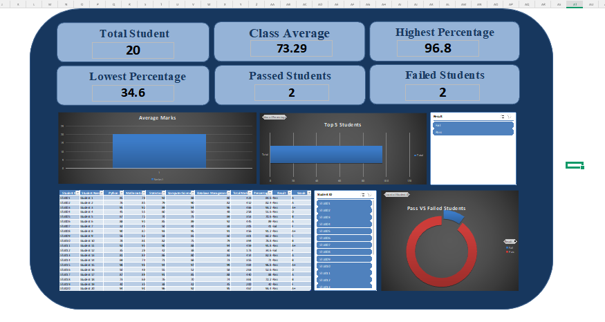

# 📊 Student Performance Analytics using NumPy

## 📌 About the Project

This project uses Python and NumPy to analyse student performance and perform different numerical operations. It focuses on array operations, mathematical calculations, statistical analysis, and data manipulation.

## 🛠️ Technologies Used

- Python
- NumPy
- VS Code
- Microsoft Excel
- Power BI
- DAX

## ✨ Features

- Array Creation
- Array Indexing and Slicing
- Array Manipulation
- Mathematical Operations
- Statistical Calculations
- Conditional Indexing
- Student Performance Analysis
- Top 5 Students Analysis
- Subject-wise Average Analysis
- Pass/Fail Analysis

## 📸 Python Project Screenshots

Screenshots of Python program outputs are available in the `screenshot` folder.

---

## 📈 Dashboard 1: Student Performance Dashboard using Excel

An interactive student performance dashboard created using Microsoft Excel to analyse student marks, percentages, and results.

### Dashboard Preview

### Features

- KPI Summary
- Total Students
- Class Average
- Passed and Failed Students
- Subject-wise Performance
- Student Performance Analysis

**Excel Dashboard File:** [View / Download Excel Dashboard](Student_Performance_Dashboard_Dashboard.xlsx)

---

## 📊 Dashboard 2: Student Performance Dashboard using Power BI

A visual and interactive dashboard developed using Microsoft Power BI and DAX to explore student performance and academic results.

### Dashboard Preview

### Features

- Total Students KPI
- Class Average
- Passed Students
- Failed Students
- Highest Percentage
- Lowest Percentage
- Subject-wise Average Marks
- Top 5 Students Ranking
- Pass vs Fail Donut Chart
- Interactive Student Name Slicer
- Student Performance Details
- Performance Summary

**Power BI Dashboard File:** [View / Download Power BI Dashboard](Student_Performance_Dashboard.pbix)

---

## 👩‍💻 Developed By

**Ananya N Puthran**
